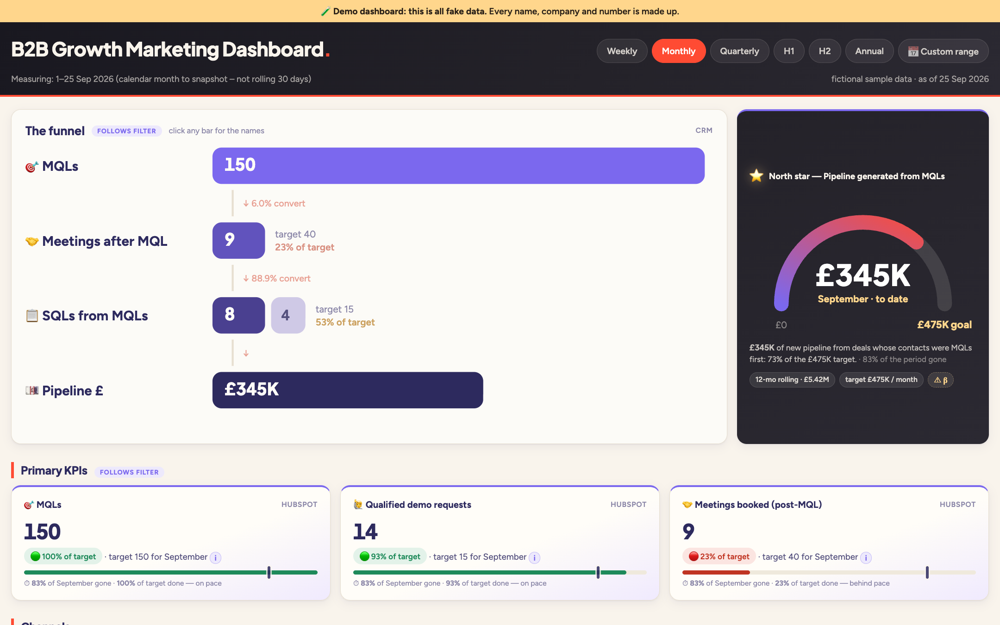
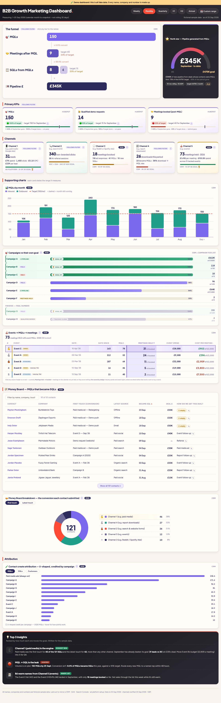
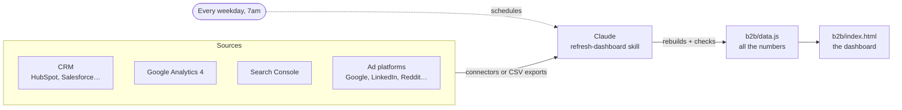

# B2B Growth Marketing Dashboard

**One page that tells a B2B marketing team whether it is on track, and what to fix first. Claude sets it up with your own data and refreshes it every morning.**



👉 **[Open the live demo](https://georgepohl2-design.github.io/growth-marketing-dashboard/b2b/)**. Nothing to install. Every name, company and number in it is made up.

Part of my series of **simple AI tools for acquisition marketers, one job each**.

---

## The problem

Most B2B marketing reporting is split across the CRM, GA4, Search Console and each ad platform. Each tool answers a different question, and none of them answers the one leadership actually asks:

> *"Are we going to hit the number, and if not, where is it leaking?"*

So every Monday somebody exports four CSVs, rebuilds the same slides, and the recap still can't say why MQLs are up while meetings are flat.

## What it does

One page that reads the whole funnel top to bottom:

| Section | What it answers |
|---|---|
| **The funnel** | MQLs → meetings → SQLs → pipeline £, with the conversion rate between each step and progress against target. Click any bar to see the contacts behind it. |
| **North star gauge** | The single metric that matters: pipeline generated from MQLs, against a £475K-a-month target that scales with the date buttons. |
| **Primary KPIs** | MQLs, qualified demo requests and meetings, each with a pace marker showing how much of the period has gone. |
| **Channels** | Five channel cards, each against its own goal. They're labelled Channel 1–5 with examples in brackets (paid media, search & AI, Reddit or Spotify Ads, report downloads, events), so you can rename them to your own. |
| **MQLs by month** | Inbound (they came to you) vs outbound (you went to them), against the monthly target. |
| **Campaigns vs goal** | Every campaign treated as an experiment with a success metric set before launch. 🏆 means the goal was hit. |
| **Events board** | MQLs, meetings held and **cost per meeting** for every event, ranked, with a cost ceiling to judge each one against. |
| **Money Board** | Every MQL that became an SQL: who, which company, first touch, latest touch, deal value. Sortable and searchable, with a breakdown chart grouping them by channel. |
| **Attribution** | U-shaped credit (40% first touch, 40% converting touch, 20% in between) by campaign, for MQLs, SQLs and customers. Typically pulled straight from your CRM's contact create attribution report. |
| **Top 3 insights** | The three recommendations that matter most for hitting the goals: the biggest win, the biggest leak, and the warmest list to work. |

Use the buttons at the top to switch between **Weekly, Monthly, Quarterly, H1, H2, Annual** or a **custom date range**. The funnel and KPI tiles recalculate from daily data, so every view stays exact.



## How it works



The page never logs in to anything. It draws whatever is in `b2b/data.js`. Claude's job is to keep that one file up to date, and to check it before the dashboard shows it.

## Set it up with your own data

### Option A: let Claude set it up and refresh it every morning (recommended)

1. **Download** this project: click the green **Code** button above → **Download ZIP**, then unzip it.
2. **Open the folder in Claude Code**: Claude desktop app → **Code** tab → choose the folder (or run `claude` in the folder from a terminal).
3. **Say "set up my dashboard".** Claude:
   - asks for your targets, channels, currency and brand terms;
   - checks which of your tools are connected to Claude (HubSpot, Google Analytics, Search Console…), and for anything that isn't, tells you exactly which CSV to export and where to save it;
   - builds your first version, checks it, and opens it so you can look it over.
4. **Say "refresh it every weekday at 7am".** Claude sets up a scheduled task. Each morning it pulls yesterday's numbers, rebuilds `data.js`, keeps a backup of the previous version, and tells you in a few lines what moved.

Want changes? Ask in plain English: *"rename Channel 3 to Reddit Ads"*, *"hide Channel 5"*, *"set the MQL target to 200 a month"*.

> Scheduled refreshes need each source on a **connector** (or a scheduled export), because nobody is around at 7am to download CSVs. Claude tells you which sources can refresh by themselves and which can't.

### Option B: any AI assistant, by hand

Export your data (see the table below), then attach **`b2b/data.js`** and your CSVs to Claude, ChatGPT or similar, and paste:

> This is the data file for a marketing dashboard. The comment at the top lists each block. Replace the sample data in those blocks with the data from my CSVs. Keep exactly the same structure and field names, and give me back the complete file.

Save the result over `b2b/data.js` and double-click `b2b/index.html`.

### Option C: edit it yourself

Open `b2b/data.js` in any text editor (TextEdit in plain-text mode, Notepad, or [VS Code](https://code.visualstudio.com/)). The comment at the top says what every block controls. Start with `TARGETS`, save, and refresh the page in your browser.

## Connect your data sources

| Source | What it feeds | Where to export it (if not using a connector) | Block in `data.js` |
|---|---|---|---|
| **CRM** (HubSpot, Salesforce, Pipedrive…) | Funnel, North Star, KPI tiles, MQLs by month, events, campaigns, Money Board | **Contacts:** filter on the "became an MQL" and "became an SQL" dates, then Export. **Meetings:** meeting activities with date and contact. **Deals:** amount, create date, original source. | `DAILY` `PEOPLE` `DEALS` `MB` `MQL_*` `EVENTS` `CAMPAIGNS` |
| **CRM attribution report** | U-shaped attribution chart | HubSpot: Reports → Attribution → *Contact create attribution*, model **U-shaped**, grouped by campaign. | `ATTRIB_MQL` `ATTRIB_CUST` |
| **Google Analytics 4** | AI-referral sessions (ChatGPT, Perplexity, Claude, Gemini, Copilot) | Reports → Acquisition → *Traffic acquisition*, filtered by **Session source**. | `P` → `ai` |
| **Google Search Console** | Non-branded organic clicks | Performance → Search results → *Queries*, with a query filter excluding your brand. | `P` → `gsc` |
| **Ad platforms** (Google Ads, LinkedIn, Meta, Reddit, Spotify…) | Channel 1: spend, clicks, CPC, lead-form submissions, leads, cost per lead | The platform's campaign performance report, daily, with lead-form columns (LinkedIn: Campaign Manager → Analyze; Google Ads: Campaigns → Download). | `P` → `li` |
| **Your plan** | Every target, pace marker and red / amber / green status | Your monthly goals | `TARGETS` |

## Make the cards yours

The channel cards ship as **Channel 1–5** with an example in brackets underneath, so anyone can see what goes where. Every KPI and channel card can be renamed, re-labelled, given a new goal or hidden from the `CARDS` block in `b2b/data.js`. The row re-flows by itself:

```js
const CARDS = {
  paid:   { show:true, emoji:'📱', title:'Google Ads', hint:'', source:'Google Ads', goal:50 },
  social: { show:false },   // only run four channels? hide one
  ...
};
```

Add a row to `EVENTS` or `CAMPAIGNS` and it appears on its board, ranked. Change `TARGETS` and every bar, pace marker and status colour follows.

## What's in this repo

```
b2b/index.html                   the dashboard (layout and charts)
b2b/data.js                      every number it shows (sample data)
CLAUDE.md                        how Claude should work in this project
.claude/skills/setup-dashboard   first-time setup, step by step
.claude/skills/refresh-dashboard the daily refresh
scripts/check_data.py            checks data.js before the dashboard uses it
dashboard.config.example.json    template for your sources, targets and schedule
inbox/                           where CSV exports land (git-ignored)
```

## Keep real numbers private

The sample data is fictional, so this repo can be public. Once `data.js` holds your company's numbers, keep your copy on your own computer or in a **private** repo. Setup git-ignores your config, exports and backups, and Claude warns you before anything real is pushed to a public repo. No API keys or passwords ever go in these files: connectors keep them in Claude.

To share the dashboard with your team, put your copy in a private GitHub repo and turn on GitHub Pages (Settings → Pages), or simply send them the folder.

## Built with

- Plain HTML, CSS and JavaScript. No frameworks, no build step, no server.
- Charts drawn as inline SVG, so they stay sharp at any size.
- Python standard library for the data checks, so it runs on any Mac or PC.
- Fonts: [Plus Jakarta Sans](https://fonts.google.com/specimen/Plus+Jakarta+Sans) and [Figtree](https://fonts.google.com/specimen/Figtree) from Google Fonts.
- Designed and built with Claude.

## About

I'm George Pohl, a growth marketer specialising in acquisition. I build small, practical tools that take the busywork out of marketing reporting. If this one is useful, ⭐ the repo or say hello on [GitHub](https://github.com/georgepohl2-design).

## Licence

[MIT](LICENSE): free to use, change and share, including at work.
